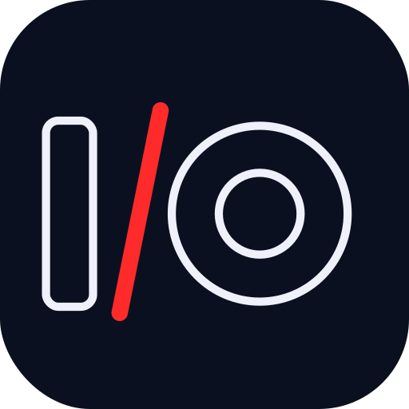

<p align="center">
  
</p>

# I/O Tower

A minimal, **no-root USB/IP server for Android TV**. Plug a USB device into the
TV, and it appears on a remote Linux PC as if it were connected locally — so the
PC's own drivers bind to it and handle everything device-specific.

I/O Tower is a **transparent USB pass-through**: it forwards raw USB transfers and
descriptors and never interprets what it is carrying. There are no device tables,
no VID/PID logic, and no per-device branches anywhere in the code. A Logitech G29
racing wheel is the running validation target, but nothing in the design is
specific to it — a plain gamepad, and in principle any non-isochronous USB device,
works the same way.

The goal is to reproduce the useful core of VirtualHere's no-root Android server,
for a single device, using only public APIs — and to lean on the Linux kernel for
the entire client side, so you write and maintain code on one end only.

## How it works

Three constraints shape the whole design:

- **No root on the TV.** Everything on the Android side goes through the public
  `android.hardware.usb.host` API. Calling `claimInterface(intf, /*forceClaim=*/ true)`
  detaches Android's own kernel driver from each interface and hands the app
  exclusive control of the endpoints — no root, no `usbfs`, no `ioctl`.
- **No protocol code on the PC.** The Linux kernel already ships the USB/IP
  client (`vhci-hcd`) and the `usbip` userspace tool, so the PC side is entirely
  stock. You never implement USB/IP on Fedora.
- **Speak stock USB/IP.** Framed correctly, the unmodified in-kernel client talks
  to the app directly. There is no custom wire format to invent.

All device-specific behavior — a wheel's mode switch and force feedback, a pad's
rumble, LEDs, calibration — is handled by the ordinary drivers on the PC
(`new-lg4ff`, Oversteer, `evdev`, …). The server just moves USB transfers back
and forth.

```
Android TV (this app)                         Fedora PC (stock tools)
  USB device
    -> USB Host API (claimInterface forceClaim)
    -> USB/IP bridge (protocol + transfer engine)
    -> foreground service, TCP :3240   <== TCP/IP ==>   vhci-hcd + usbip attach
                                                          -> real /dev device
                                                          -> class driver / new-lg4ff / Oversteer / evdev
```

## Quick start

On the PC side there is nothing to build — just the stock tools:

```bash
sudo modprobe vhci-hcd
usbip list -r <tv-ip>                      # see what the TV exports (no root needed)
sudo usbip attach -r <tv-ip> -b <busid>    # attach it (needs root)
lsusb                                 # the device is now present locally
evtest                                # or Oversteer, or the device's own tooling
```

Install the tools with `sudo dnf install usbip usbutils` on Fedora if they are
missing.

## Running a Logitech G29 (force feedback)

> **Set the wheel to PC mode.** On Fedora with Oversteer this is the **only mode
> that produces force feedback**. In PC mode the G29 enumerates as `046D:C24F`
> (a 2-interface composite) and the PC's `logitech` / `new-lg4ff` driver binds it
> *with* FFB. PS3/native mode enumerates as `046D:C260` (single interface) and the
> PC falls back to `hid-generic` -- inputs work but there is **no force feedback**;
> **PS4 mode does not pass through at all**. If `evtest` shows no `EV_FF` or
> Oversteer reports "No device available", the wheel is in the wrong mode.

**On the TV** (first time needs one tap, then it is automatic):

1. Install / launch the app (Android Studio **Run**, or `./gradlew :android:installDebug`).
2. Plug the wheel into the TV. The app auto-claims it on attach. Grant the USB
   permission prompt the first time -- on a non-touch TV you can confirm it over
   adb with `adb shell input keyevent 66`. Once claimed, `forceClaim` detaches the
   kernel driver and the UI stops scrolling. Confirm in logcat:
   `opened + claimed 2/2 interface(s); endpoints: 0x81 0x1 0x82`.

**On Fedora:**

```bash
sudo modprobe vhci-hcd
usbip list -r <tv-ip>                       # the G29 (046d:c24f) is listed
sudo usbip attach -r <tv-ip> -b <busid>     # attach it

lsusb | grep -i logitech                    # 046d:c24f is now present locally
dmesg | grep -iE 'logitech|lg4ff'           # the `logitech` driver bound + "Force feedback support"
sudo evtest                                 # select the G29 -- EV_FF (FF_CONSTANT/…) is listed
oversteer                                   # detects the wheel; its FFB test physically turns it
```

Detach when done (find the port with `usbip port`):

```bash
sudo usbip detach -p <port>
```

### Reconnecting after a detach or mode switch

When the wheel is unplugged (or re-enumerates), I/O Tower on the TV releases it
and **re-claims it automatically on replug** -- you don't touch the app. On the
PC, just re-attach:

```bash
sudo usbip attach -r <tv-ip> -b <busid>
```

The stock Linux `vhci-hcd` client often wedges after an abrupt disconnect, so if
`usbip attach` (or even `usbip port`) fails with `usbip: error: open vhci_driver`,
reset the client module and retry:

```bash
sudo modprobe -r vhci-hcd        # if this says "in use", reboot the PC to clear it
sudo modprobe vhci-hcd
sudo usbip attach -r <tv-ip> -b <busid>
```

Automating this -- keeping `vhci-hcd` healthy and re-attaching hands-off after a
drop -- is the job of the optional PC companion (architecture.md §9, milestone
M10), now implemented in `companion/iotowerd.py`: it waits for the export,
attaches, re-attaches automatically when the device resets/re-enumerates, reloads
a wedged `vhci-hcd`, and detaches cleanly on any drop and on exit. The manual sequence above
stays the no-companion baseline. (The companion's optional PIN/TLS gate, §9.2, is
a future milestone -- M11.) See [`companion/README.md`](companion/README.md).

If the wheel binds as `hid-generic` even in PC mode, install the `new-lg4ff`
driver (FF-capable Logitech HID) and Oversteer per their docs.

## Status

Early / in development. Protocol codecs (M1), the descriptor parser + endpoint
map (M2), `DEVLIST` negotiation (M3), `IMPORT` + control transfers (M4), and the
asynchronous interrupt/bulk transfer engine with `CMD_UNLINK` cancellation (M5)
are done — a fake device enumerates in `lsusb` and streams scripted input over
the desktop harness, **so the entire USB/IP protocol is now proven with no
Android and no hardware**. The M6 Host-API spike (`HostApiSpike`:
`claimInterface(forceClaim)` on every interface + interrupt-IN read to Logcat,
no network) **passed its L3 gate on real hardware** — a Logitech F310 was
claimed with no root and its live input streamed to Logcat, confirming the
no-root premise (§2). M7 wires that proven server into the foreground `ServerService` behind a real `AndroidUsbBackend` — Host-API `submit`/`cancel` on interrupt/bulk endpoints, reading each interrupt-IN endpoint on demand (one `bulkTransfer` bound to each client URB), with the device's redundant `SET_CONFIGURATION` no-op-ACKed and `CLEAR_FEATURE(ENDPOINT_HALT)` recovery on a stalled read — so a generic pad plugged into the TV reaches the PC over the network. **Its L3 hardware gate passed on the TV (2026-10-16):** `usbip attach` from Fedora, then live F310 input in `evtest`. M7d then fixed the M7 read-path rough edges (an idle-timeout misread as an
endpoint error; a post-unplug busy-loop). **M8 is largely proven (2026-10-19):**
a Logitech G29 in **PC mode** passes through to Fedora, where `new-lg4ff` binds
and **force feedback drives the wheel** via Oversteer -- OUT transfers and the
2-interface composite both carried with no device-specific code. Reset recovery works too: on a detach the TV releases the wheel and re-claims it
on replug, and the PC re-attaches with `usbip attach` (reloading `vhci-hcd` if the
stock client wedges). **M8 is complete.** **M9 robustness** -- reset recovery, screen-off survival, and clean client disconnect -- is **MET on the TV (2026-10-20)** for gates 1-3 (the latency/jitter measurement is deferred to an end-of-v1 pass). **M10's optional PC companion** (`companion/iotowerd.py`) is implemented -- auto-attach, auto-reattach on reset, clean detach-on-drop and teardown -- with its L3 hands-off gate pending on hardware; its PIN/TLS security gate is split out to a future milestone (**M11**). The TV app's launcher UI is finalized, with an **Eject** control that releases the device (the matching clean `usbip detach` on the PC is the companion's job). See "Running a Logitech G29" below. The full
design, protocol details, concurrency model, and the milestone plan with pass
gates live in [`architecture.md`](architecture.md) and
[`MILESTONES.md`](MILESTONES.md).

The build order is **testability-ordered**: the entire USB/IP protocol is proven
locally first — codecs, then the descriptor parser, then `DEVLIST`, `IMPORT`, and
the interrupt-IN transfer engine, all against a fake device with the stock
`usbip` client and no hardware — and only then is it ported to the TV
(`claimInterface`), validated on the G29 (force feedback), and hardened (reset
recovery, lifecycle, latency).

## Scope and limitations

- **Isochronous transfers are unsupported.** The Android Host API cannot do them,
  which excludes webcams and USB audio. Everything else — control, interrupt, and
  bulk — is supported, including OUT transfers (force feedback, rumble, LEDs).
- **One device and one client at a time** in v1. Multiple simultaneous inputs
  (e.g. a USB hub of controllers) are planned for v2 — see architecture.md §10.
- **No auth or encryption in the core server.** It assumes a trusted LAN by
  default. An optional PC-side companion daemon can add auto-attach, auto-reattach
  on device reset, and a PIN/TLS gate via a localhost proxy — off the app's
  critical path (see §9 of the architecture doc). Auto-attach/reattach are
  implemented (M10); the PIN/TLS gate is a future milestone (M11).

## Building

A **Java** multi-module Gradle project. Most of the logic lives in a pure-Java
`core` module with no Android dependency, so it builds and tests on a plain JVM;
only the Android app touches the USB Host API.

```bash
./gradlew :core:test        # fast protocol/engine unit tests — no SDK, no device
./gradlew :desktop:run      # run the server against a fake device, attach with stock usbip
./gradlew :android:assembleDebug   # build the TV app (needs the Android SDK)
```

Layout: `core/` (protocol + engine, pure Java), `android/` (the TV app),
`desktop/` (local test harness), `companion/` (optional Python PC daemon, §9),
`testdata/` (captures). Toolchain and the full build/test guide are in
[`DEVELOPING.md`](DEVELOPING.md).

## Deploying to the TV (ADB over the network)

The TV app is installed and debugged over the network with `adb` — no cable.
One-time setup on the TV: enable **Developer options** (Settings → System →
About → click *Build* 7×), then turn on **USB debugging** under Developer
options. On most Android TVs that also opens network ADB on port 5555; newer
Google TV boxes instead expose a separate **Wireless debugging** toggle that
needs a pairing step (see below). Find the TV's IP under Settings → Network &
Internet → your (Ethernet) connection, or the *Status* screen.

```bash
# Connect (accept the "Allow debugging?" prompt on the TV the first time)
adb connect <tv-ip>:5555
adb devices                     # TV should show as "device" (not "unauthorized"/"offline")

# Install / update the app (reinstalls in place, keeps data; same command each time)
./gradlew :android:installDebug
#   or directly:
adb install -r android/build/outputs/apk/debug/app-debug.apk

# Watch the app's logs. The app runs the USB/IP server (it auto-exports a
# plugged-in device; there is no Start button -- see the Eject note below). To watch
# everything from the app's process, all tags:
adb logcat --pid=$(adb shell pidof -s com.iotower.android)

# Launch / stop the app from the PC (optional)
adb shell am start -n com.iotower.android/.MainActivity
adb shell am force-stop com.iotower.android

# List the USB devices the TV sees (handy when several are attached)
adb shell dumpsys usb | sed -n '/USB Host State/,/^$/p'
```

**Wireless-debugging fallback.** If `adb connect <ip>:5555` is refused, the TV is
on the newer secure flow: Developer options → **Wireless debugging → Pair device
with pairing code**, then use the pairing host:port and 6-digit code it shows,
and connect to the *debug* host:port (both differ from 5555):

```bash
adb pair <tv-ip>:<pairing-port>     # enter the 6-digit code
adb connect <tv-ip>:<debug-port>
```

**Tips.** A stale connection shows as `offline` — `adb disconnect` then
`adb connect` again clears it. DHCP can change the TV's IP after a reboot;
reserve it on the router if you reconnect often. A signature mismatch on install
(`INSTALL_FAILED_UPDATE_INCOMPATIBLE`, e.g. after building on a different
machine) needs `adb uninstall com.iotower.android` first. The M7 L3 gate — plug
in a generic pad (the app auto-exports it), then `usbip attach` from Fedora to the TV's IP and
watch live input in `evtest` — is in [`MILESTONES.md`](MILESTONES.md). (The M6
`HostApiSpike` that logged under `IoTowerSpike` is retained as a diagnostic but is
no longer wired to the app's serve path.)

## Documentation

- [`architecture.md`](architecture.md) — full design: goals and constraints, the
  USB/IP protocol surface, URB-to-Host-API mapping, concurrency model, latency
  notes, device-reset handling, the optional PC companion, scope, build order,
  testing, and a risk register.
